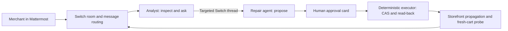

# AgentCoSign Fix Room

A stock repair workflow for a Shopify development store, coordinated by two
custom AI agents in a real Switch room. A human provides the inventory fact and
approves the exact proposal. Only ordinary backend code can mutate inventory.

## Why this matters

A merchant reports “the towel cannot be bought”, supplies the warehouse quantity,
and approves a precise repair in chat. The result is checked against the actual
storefront and a fresh cart, rather than reported from the inventory API alone.

## Architecture

Switch is the message, membership and handoff layer. Anthropic interprets and
explains; deterministic Node code controls writes; Playwright checks shopping.
See [live acceptance](submission/ACCEPTANCE.md), [demo script](submission/DEMO.md)
and [submission description](submission/SUBMISSION.md).

## Requirements

Node 24+, Switch server with a bridged room (Mattermost recommended), two custom
agent registrations with the same owner, an Anthropic API key, and a Shopify
development store with a single dedicated inventory-tracked test product.
The self-contained fixed-probe mode needs no private checkout. Full shopping-agent mode uses an existing AgentCoSign checkout and is configured separately below.

## Setup

1. Run `npm ci` and `npx playwright install chromium`.
2. Copy `.env.example` to `.env`; keep it private.
3. Start a Switch stack with its Mattermost profile (tested with Switch core
   0.31.0 and Mattermost 11.9.0; see the
   [Switch docs](https://docs.switchagents.ai/switch-rooms/getting-started/add-a-second-agent)).
   Copy that stack's env file to `infra/.env`, then run
   `node scripts/register-agents.mjs` and `node scripts/create-room.mjs`. They
   write the agent keys and room ID to `.runtime/` (keep it private) and expect the
   API on port 18000. The room is named Fix Room, which the bridge exposes as
   channel `fix-room` in team `switch`; set `MATTERMOST_TEAM` and
   `MATTERMOST_CHANNEL` if yours differ. Invite both agents and the merchant.
   Configure both to accept their owner and sibling agents. Switch disallows an agent changing its own settings: use the owner's
   settings or have sibling agents configure each other.
4. Fill the agent IDs, API keys and room ID. `MERCHANT_PARTICIPANT_ID` is the human UUID returned by Switch `list_participants`.
   `MERCHANT_SENDER_ID` is that person’s transport sender from an independently
   verified room message; `ANALYST_SENDER_ID` is the analyst’s transport sender.
   These differ from participant UUIDs. Do not use display names as identity.
   The worker checks participant type on connect.
5. Create a fictional stock test product in your dev store, track inventory,
   deny selling when out of stock, and record inventory item, location, variant
   IDs and product handle. Set its baseline available inventory to zero yourself.
   Configure the Admin app's product/inventory read and inventory write scopes.
   Supply app client credentials. Existing fixtures can be used; no fixture seed
   command is included yet. Never use a production store.
6. Fill Anthropic settings and storefront password; run `npm start`.

## Full shopping-agent mode

Set `AGENTCOSIGN_ROOT` to an existing AgentCoSign checkout with its Python environment,
OpenClaw browser driver, report app bundle and model configuration already installed.
The wrapper in `scripts/run-shopping-agent.py` runs the same cart-only shopping task
before and after a stock repair, retains the browser trajectory and screenshots,
and uses the existing report builder to generate an English shopping replay.
Authentication details are redacted from the rendered replay. Raw records remain private.

In this mode the shopping agent must observe either the disabled Sold out button
or the matching item, quantity and price in its cart. A separate Playwright probe
must confirm the same outcome. A model saying DONE alone is insufficient. Reset
is only fixture preparation and continues to use the fixed probe. The Switch
analyst and repair agent still handle the evidence, warehouse fact, proposal and
human approval. The shopping agent cannot mutate inventory.

The existing AgentCoSign harness and report app are not bundled in this repository;
without that checkout, leave `AGENTCOSIGN_ROOT` empty to use fixed-probe mode.
Do not present fixed-probe results as a full model-driven shopping-agent visit.

## Room flow

Talk to the analyst naturally in Chinese or English, for example “Why can’t customers buy the towel?”.
The analyst checks the real storefront and cart, then asks for the actual sellable
quantity. Reply naturally, for example “The warehouse has 25 units.”. The single pending case is
resolved internally; multiple pending cases require clarification.

The analyst hands the fact to the repair agent through a real Switch thread.
The repair agent shows the exact before/after quantity and native Mattermost
**Approve reset to 0 units / Approve restock to 25 units / Cancel** buttons. Only the configured human merchant can act on the
current proposal. The server verifies a confidential callback token, room, post,
proposal hash and state; duplicate or old button actions only display status and never repeat the write. Textual
approval is not accepted. A click never authorizes a later proposal.

After approval, the worker re-reads the snapshot, writes with compare-and-swap
and a stable idempotency key, reads back, waits for public availability (at most
six checks ten seconds apart; 429 stops immediately), and runs a clean browser
cart retest. Results return to the room and update the original card. Cancel leaves stock unchanged.
Completed-card status buttons write their response visibly into that same card.

To restore the simulated fixture, say “Reset the test inventory to zero.”, reply with zero when
asked, then approve its card. No case IDs, commands or hashes need copying.

## Mattermost button setup

Set MATTERMOST_URL, MATTERMOST_INTEGRATION_USER and
MATTERMOST_INTEGRATION_PASSWORD to an existing integration/admin account able to
patch the repair bot’s post. MATTERMOST_MERCHANT_USERNAME identifies the human
who may approve. These credentials stay local; they are not sent to the model.

The callback listener uses MATTERMOST_ACTION_PORT (default 18082). Set
MATTERMOST_ACTION_URL to a URL reachable by the Mattermost server, such as
http://host.docker.internal:18082/actions for Docker Desktop. Check the selected
port is free; use the same port in both settings. Only a POST with a confidential
per-proposal token is accepted; there are no read endpoints.

If the callback host is private, a server administrator must explicitly allow
that exact hostname in Mattermost AllowedUntrustedInternalConnections. Preserve
existing entries. Container environment variables override saved server config;
update the deployment configuration and restart only Mattermost when needed.
Do not disable the private-host restriction globally. This package does not
change that setting automatically.

For local deployments, set Mattermost SiteURL and WebsocketURL to the actual
browser-reachable host and published port, for example `http://127.0.0.1:18065`
and `ws://127.0.0.1:18065`. An incorrect real-time address can leave cards stale
even when the backend has completed the work. Use wss for an HTTPS deployment.

In fixed-probe mode the shopper is a fixed-task Playwright probe, not a
model-driven shopper. It uses the public product page and ordinary Add to cart button, then reads the
same browser context's Ajax cart. It receives no Admin credentials or warehouse
facts. Its current selectors target a standard Shopify product form; custom
storefronts may require adapting the probe. No checkout or payment.

SQLite state, screenshots and actual cart JSON are under `runs/`. Do not publish
that directory without reviewing it. Keep agent/model/store credentials private.
Model inputs contain only supplied evidence and resource snapshots.

## Limits and failure behavior

Stock only. No promotion/pack workflow, seed-store command, automatic rollback,
or automatic mutation retries. HTTP 429 pauses the storefront queue across cases;
after cooldown, the merchant can send `resume storefront` before an explicit new run.
A changed snapshot blocks the case. A failed or
unknown write must be read back and reconciled by the operator before a new
proposal. Interrupted active cases remain in SQLite; do not replay approvals.
Reconnect reads room history since first start and deduplicates processed messages.
Truncated history is refused. Interrupted active cases require operator reconciliation;
do not claim automatic crash recovery or replay an unknown write.

The self-contained bundle uses a fixed browser probe. The optional full shopping-agent
adapter calls an existing AgentCoSign checkout; that harness and replay app are not bundled. This package does not promise a
15-minute setup on an unconfigured Shopify store.

## Verification

`npm test` checks identity/hash/state approval boundaries, persistent message
deduplication, changed-baseline refusal, idempotency/CAS parameters and no blind
write retry. Unit tests do not substitute for a human-approved live room run.

MIT licensed; see [LICENSE](LICENSE). Dependencies retain their own licenses.
