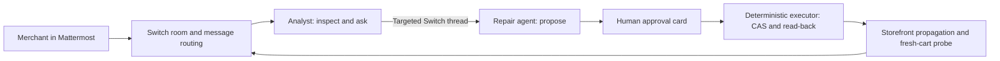

# AgentCoSign Fix Room

A store repair workflow for a Shopify development store, coordinated by two custom
AI agents in a real Switch room. It handles two faults: a product wrongly sold out,
and a coupon that the page advertises but the store rejects. A human provides the
business fact and approves the exact proposal. Only ordinary backend code can write
to the store.

## Why this matters

A product page promises 20% off from $30, but the coupon is configured for $50. A
customer with a $32 cart is refused, and nothing in the admin looks wrong. The
shopping agent finds this by trying to buy. The analyst shows the merchant both
numbers and asks which one the campaign approved. After approval, the result is
checked by the discount a fresh cart actually receives, not by the admin setting.
The same workflow repairs a product whose inventory wrongly reads zero.

**Latest public-client live result (November 4, 2026):** a human approved FIXROOM20 minimum $50 → $30; read-back preserved 20% and the other recorded settings. The bundled public shopper and independent probe agreed on $6.40 off and $25.60 before tax/shipping. No checkout or payment. See [acceptance and verification limits](submission/ACCEPTANCE.md).

## Demo

[Watch the final two-minute demo on YouTube](https://youtu.be/FEW8cEMk9xg).

The final two-minute demo includes the builder’s English narration and face-to-camera inset, real Shopify shopping before and after repair, both native human approvals, the targeted Switch handoff, and automatic completion without a page refresh. The incident is deliberately configured on fictional development-store products. Edited, held and sped-up scenes are labeled; no checkout or payment occurs.

## Architecture

Switch is the message, membership and handoff layer. Anthropic interprets and
explains; deterministic Node code controls writes; Playwright checks shopping.
See [live acceptance](submission/ACCEPTANCE.md), [demo script](submission/DEMO.md)
and [submission description](submission/SUBMISSION.md).

## Requirements

Node 24+, Switch server with a bridged room (Mattermost recommended), two custom
agent registrations with the same owner, an Anthropic API key, and a Shopify
development store with a single dedicated inventory-tracked test product.
The default `SHOPPER_MODE=public` bundles a model-driven browser shopper and needs no private checkout. See [judge reproduction guide](submission/JUDGE-GUIDE.md). The latest coupon acceptance used this public driver with real Anthropic/Shopify and human approval; older private-driver evidence is identified separately.

## Setup

1. Run `npm ci` and `npx playwright install chromium`.
2. Copy `.env.example` to `.env`; keep it private.
3. Start a Switch stack with its Mattermost profile (tested with Switch core
   0.31.0 and Mattermost 11.9.0; see the
   [Switch docs](https://docs.switchagents.ai/switch-rooms/getting-started/add-a-second-agent)).
   Copy that stack's env file to `infra/.env`, then run
   `node scripts/register-agents.mjs` and `node scripts/create-room.mjs`. They
   write the agent keys and room ID to `.runtime/` (keep it private) and expect the
   API on port 18000. The room is named Fix Room, which the bridge exposes as
   channel `fix-room` in team `switch`; set `MATTERMOST_TEAM` and
   `MATTERMOST_CHANNEL` if yours differ. Invite both agents and the merchant.
   Configure both to accept their owner and sibling agents. Switch disallows an agent changing its own settings: use the owner's
   settings or have sibling agents configure each other.
4. Fill the agent IDs, API keys and room ID. `MERCHANT_PARTICIPANT_ID` is the human UUID returned by Switch `list_participants`.
   `MERCHANT_SENDER_ID` is that person’s transport sender from an independently
   verified room message; `ANALYST_SENDER_ID` is the analyst’s transport sender.
   These differ from participant UUIDs. Do not use display names as identity.
   The worker checks participant type on connect.
5. Create a fictional stock test product in your dev store, track inventory,
   deny selling when out of stock, and record inventory item, location, variant
   IDs and product handle. Set its baseline available inventory to zero yourself.
   Configure the Admin app's product/inventory read and inventory write scopes.
   Supply app client credentials. Existing fixtures can be used; no fixture seed
   command is included yet. Never use a production store.
6. Fill Anthropic settings and storefront password; run `npm start`.

## Public shopping-agent mode (default)

Set `SHOPPER_MODE=public`, `ANTHROPIC_API_KEY` and `ANTHROPIC_MODEL` in your private `.env`.
For local runs set `SHOPPER_HEADLESS=false` as in the sample. If Shopify shows Verify browser,
the client waits for the human in that visible browser; it does not ask the model to solve it.
Headless challenges stop the visit. Optional `SHOPPER_RECORD_VIDEO=true` retains local browser
footage, including authentication screens; raw recordings are private and must be reviewed before sharing.
The included `src/public-shopper.mjs` sends only the cart-only task, redacted page text and
visible control descriptions to Anthropic. The model chooses browser actions; Playwright
executes those actions in a fresh context. The shopper receives no Shopify Admin credentials
or write tools. Browser observations, decisions and a final screenshot are saved locally.

Both coupon and stock visits require the agent's observed outcome to agree with a separate
fixed-task Playwright probe. A DONE report alone cannot pass. Coupon rejection ends the visit;
there is no failed-code retry. Out-of-scope navigation, checkout, extra tabs, 429 and browser
challenges block completion. This is a bounded test-product shopper, not arbitrary shopping.
Reset is fixture preparation and uses the deterministic probe.

`SHOPPER_MODE=probe` explicitly selects fixed checks without a model-driven shopper. Do not
present those as an autonomous shopping-agent visit.

`SHOPPER_MODE=legacy` with `AGENTCOSIGN_ROOT` optionally calls an existing private AgentCoSign
Python/OpenClaw harness and replay app through the included wrapper scripts. That external
harness is not bundled and is not required by public mode. Legacy mode produced the earlier historical acceptance. The latest completed coupon repair uses the bundled public client with real Anthropic/Shopify. Local scripted-decision tests remain separate from that live evidence.

## Room flow

Talk to the analyst naturally in Chinese or English, for example “Why was the FIXROOM20
coupon rejected?” or “Why can’t customers buy the towel?”. The analyst checks the real
storefront and cart, then asks for the fact only the merchant has: the approved campaign
minimum or the actual sellable quantity. Reply naturally, for example “The campaign minimum
is $30.” or “The warehouse has 25 units.”. The single pending case is resolved internally;
multiple pending cases require clarification.

The analyst hands the fact to the repair agent through a real Switch thread.
The repair agent shows the exact before/after quantity and native Mattermost
**Approve reset to 0 units / Approve restock to 25 units / Cancel** buttons. Only the configured human merchant can act on the
current proposal. The server verifies a confidential callback token, room, post,
proposal hash and state; duplicate or old button actions only display status and never repeat the write. Textual
approval is not accepted. A click never authorizes a later proposal.

After approval, the worker re-reads the snapshot, writes with compare-and-swap
and a stable idempotency key, reads back, waits for public availability (at most
six checks ten seconds apart; 429 stops immediately), and runs a clean browser
cart retest. Results return to the room and update the original card. Cancel leaves stock unchanged.
Completed-card status buttons write their response visibly into that same card.

To restore a simulated fixture, say “Reset the test inventory to zero.” or “Reset the coupon
test.”, reply with 0 or $50 when asked, then approve its card. No case IDs, commands or hashes
need copying.

## Coupon case setup

Create a percentage code for one dedicated test product with a minimum subtotal above what its
product page advertises, for example a page promising $30 and a code requiring $50. Set
`DISCOUNT_ID`, `DISCOUNT_CODE`, `OFFER_HANDLE` and `OFFER_VARIANT_ID`. The Admin app also needs
the `read_discounts` and `write_discounts` scopes. Without these settings the coupon workflow stays off.

The check adds two items, applies the code once through the cart's Discount section, then reads
the same session's cart. It requires the code to be applicable, the exact percentage off the line
subtotal, and the matching merchandise subtotal. It does not start checkout. Shopify has no
compare-and-set for this write, so the worker compares a fresh read just before writing and reads
back afterwards, which leaves a small window for a concurrent edit.

## Mattermost button setup

Set MATTERMOST_URL, MATTERMOST_INTEGRATION_USER and
MATTERMOST_INTEGRATION_PASSWORD to an existing integration/admin account able to
patch the repair bot’s post. MATTERMOST_MERCHANT_USERNAME identifies the human
who may approve. These credentials stay local; they are not sent to the model.

The callback listener uses MATTERMOST_ACTION_PORT (default 18082). Set
MATTERMOST_ACTION_URL to a URL reachable by the Mattermost server, such as
http://host.docker.internal:18082/actions for Docker Desktop. Check the selected
port is free; use the same port in both settings. Only a POST with a confidential
per-proposal token is accepted; there are no read endpoints.

If the callback host is private, a server administrator must explicitly allow
that exact hostname in Mattermost AllowedUntrustedInternalConnections. Preserve
existing entries. Container environment variables override saved server config;
update the deployment configuration and restart only Mattermost when needed.
Do not disable the private-host restriction globally. This package does not
change that setting automatically.

For local deployments, set Mattermost SiteURL and WebsocketURL to the actual
browser-reachable host and published port, for example `http://127.0.0.1:18065`
and `ws://127.0.0.1:18065`. An incorrect real-time address can leave cards stale
even when the backend has completed the work. Use wss for an HTTPS deployment.

In fixed-probe mode the shopper is a fixed-task Playwright probe, not a
model-driven shopper. It uses the public product page and ordinary Add to cart button, then reads the
same browser context's Ajax cart. It receives no Admin credentials or warehouse
facts. Its current selectors target a standard Shopify product form; custom
storefronts may require adapting the probe. No checkout or payment.

SQLite state, screenshots and actual cart JSON are under `runs/`. Do not publish
that directory without reviewing it. Keep agent/model/store credentials private.
Model inputs contain only supplied evidence and resource snapshots.

## Limits and failure behavior

Stock and coupon minimum only. No pack workflow, seed-store command, automatic
rollback, or automatic mutation retries. The product page wording is never changed. HTTP 429 pauses the storefront queue across cases;
after cooldown, the merchant can send `resume storefront` before an explicit new run.
A changed snapshot blocks the case. A failed or
unknown write must be read back and reconciled by the operator before a new
proposal. Interrupted active cases remain in SQLite; do not replay approvals.
Reconnect reads room history since first start and deduplicates processed messages.
Truncated history is refused. Interrupted active cases require operator reconciliation;
do not claim automatic crash recovery or replay an unknown write.

The public bundle includes a model-driven browser client and an independent fixed probe. Historical replay rendering still uses an optional external harness. Manual fixture and infrastructure setup is required; no hosted judge credentials or one-click deployment is supplied.

## Verification

`npm test` checks identity/hash/state approval boundaries, persistent message
deduplication, changed-baseline refusal, idempotency/CAS parameters and no blind
write retry. Unit tests do not substitute for a human-approved live room run.

`npm run test:browser` uses a local simulated shop, real Chromium and scripted decisions (no API key or paid calls). It tests delayed cart updates, rejected/successful coupons, checkout blocking and unsupported DONE. See submission/JUDGE-GUIDE.md for the full development-store procedure and the remaining live-validation boundary.

MIT licensed; see [LICENSE](LICENSE). Dependencies retain their own licenses.
